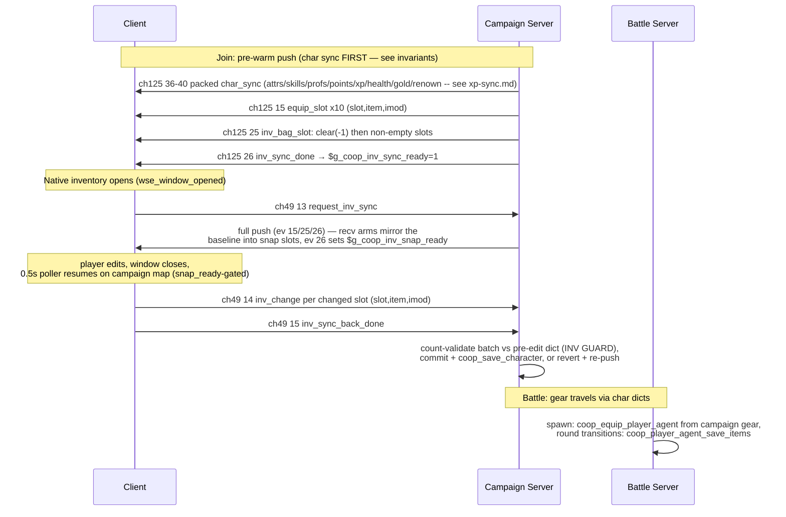

# Flow: Inventory Sync (equip pushes, bag sync, screen close-diff)

**Status:** AUDITED
**Validated against commit:** `7161f85` (doc refresh 2026-09-21: every
`module_coop_scripts.py` / `module_simple_triggers.py` anchor re-pointed
after the Plan 3/4 relation + quest scripts and the outbox drain shifted
them; verdicts unchanged -- no runtime-verified inventory fix since
`cfef13a`). Prior stamp `cfef13a` (visit scenes block the
inventory key; in-scene trade replays through the client outbox,
runtime-verified 2026-09-19 -- see Related docs; this flow's own events
and anchors are unchanged). Prior stamp `cc6242a` (PR #1 port plan 1:
rows 7-11 runtime-verified 2026-09-18, plus the trade drop-slot fix
`0f2855d`). Prior stamp `2923381` (line anchors re-verified in full static doc audit
2026-08-30; runtime-verified behavior unchanged since `ce0e287`). Prior stamp `ce0e287` (steamid persistence,
runtime-verified 2026-08-23: char-dict naming is sid-keyed for
Steam-identified players and the join-time pre-warm push now fires from
`coop_player_hydrate` (ch49 identify / 5 s fallback), not the join handler;
this flow's own events are unaffected. Prior stamp `9681486`: the join-time
char sync this dossier's sequence diagram references is now 5 packed
messages, ch125 ev 36-40, not the old per-value events 16-24 — see
`xp-sync.md` for the char-sync detail; this flow's own events (15/25/26,
ch49 13/14/15) are unaffected. Prior: `9558722`, B2 push-on-mutation + B3
receive-handler baseline runtime smoke passed 2026-07-25, incl. the
smoke-session trade-purchase fix `6c4db5c`; row 6 fix + join-push
ordering 2026-07-10, group-C rows 4/5 2026-07-11)

## Scope

How a player's equipment (slots 0–9) and bag (slots 10–105) stay in sync
between the campaign server's authoritative troop struct and the client's
native inventory screen, and how gear reaches the battle server. Entry
points: campaign join (pre-warm push), native inventory window open/close,
battle spawn. Exit state: server troop + the per-player char dict
(`coop_char_sid_<acctid>` / `coop_char_<name>`, see key-builders) reflect
client edits. The trade screen has its own synced flow (ch49 ev 20–22 /
ch125 ev 29–32) and is out of scope here.

Module paths relative to `wse2work/Native-Coop-master/`.

## Sequence diagram

## Code anchors

| # | Step | File | Line | Symbol |
|---|------|------|------|--------|
| 1 | Equip push on join (ev 15) | `module_coop_scripts.py` | 14665–14676 | `coop_send_equipment_to_client` |
| 2 | Bag push on join (ev 25/26, clear signal, non-empty only) | `module_coop_scripts.py` | 14678–14706 | `coop_send_inventory_to_client` |
| 3 | Push call sites (join) | `module_coop_scripts.py` | 9488 | `coop_player_hydrate` (def 9321) calls `coop_push_player_inventory` (14713–14718, equip then bag) — the pushes live in the hydrate script, not the join handler |
| 4 | Client equip recv (troop struct + mirror) | `module_coop_scripts.py` | 12740–12757 | ev 15 arm (troop write gated by `coop_inv_recv_mirror_ok` 7370–7391; mirror always writes snapshot slots 160–179 via `slot_coop_inv_snap_equip_item/mod_begin` — see audit row 4) |
| 5 | Client bag recv + sync-ready flag | `module_coop_scripts.py` | 7399–7439 | `coop_client_recv_inventory` (bag/done arms; the script continues with the trade arms) — `$g_coop_inv_sync_ready`, `$g_coop_inv_snap_ready` set 7437–7439 |
| 6 | Inventory-open re-sync request | `module_scripts.py` | 51183–51283 | `wse_window_opened` (window_inventory arms 51194–51229: visit-scene arm 51194–51207 promotes an armed trade only, map arm 51208–51229 flushes a still-open session 51210–51219 then sends ev 13) |
| 7 | Presentation-side baseline (coop item select) | `module_presentations.py` | 13625–13667 | on `$g_coop_inv_sync_ready` |
| 8 | Close-diff gate + send (equip then bag) | `module_simple_triggers.py` / `module_coop_scripts.py` | 4768–4774 / 9770–9793 | 0.5s poller gate calls `coop_inv_client_diff_and_send`, ev 14 per changed slot, ev 15 done; bag bound from `coop_inv_bag_cap` (9754–9764) |
| 9 | Server apply (validated) + save | `module_coop_scripts.py` | 12990–12994, 13007–13022 / 14562–14661 | dispatcher arms (ev 13 / ev 14 with slot + item-id validation / ev 15) / `coop_inv_sync_back_validate_and_save` |
| 10 | Char dict save/load carries imod | `module_coop_scripts.py` | 7974–7997 (save), 8303–8333 (load) | in `coop_save_character` (def 7818) / `coop_load_character` (def 8168) |
| 11 | Battle server: pre-spawn inventory access | `module_coop_scripts.py` | 3074–3097 | `coop_player_access_inventory` |
| 12 | Battle server: spawn equip from campaign gear | `module_coop_scripts.py` | 3126–3144 | `coop_equip_player_agent` |
| 13 | Battle server: persist agent items at round transition | `module_coop_scripts.py` | 3103–3117 | `coop_player_agent_save_items` |
| 14 | Battle server: item-bug guard | `module_coop_scripts.py` | 3146–3181 | `coop_check_item_bug` |

## State & events

- **Events:** ch125: `equip_slot`=15, `inv_bag_slot`=25, `inv_sync_done`=26;
  ch49: `request_inv_sync`=13 (re-added deliberately by B3 `2f2f2bc` per
  the C7 note — client sends on screen open, server replies with the full
  push), `inv_change`=14, `inv_sync_back_done`=15 (`header_common.py`).
- **Client globals:** `$g_coop_inv_screen_open` (0 idle / 1 open / 2 close
  processed; set by `wse_window_opened`), `$g_coop_inv_sync_ready`,
  `$g_coop_inv_snap_ready` (baseline mirrored — close-diff may run; set by
  ev 26, cleared when the diff fires or a trade close suppresses it).
- **Snapshot slots** on `trp_temp_troop`: equip items 160–169, equip mods
  170–179, bag items 180–275, bag mods 276–371
  (`module_constants.py:1986–1989`).
- **Dict:** equipment + bag with imods persisted per player in the char
  dict (`coop_char_sid_<acctid>.wsedict` for Steam-identified players,
  `coop_char_<name>.wsedict` otherwise — naming owned by the
  `coop_char_store_dict_name[_raw]` key-builders since `ce0e287`) by
  `coop_save_character`.

## Invariants

- Slots 0–9 are equipment, 10–105 bag; the bag push sends a clear signal
  (slot −1) before non-empty slots to purge stale client state without
  overflowing the send buffer (`:14687–14701`).
- A validated `inv_sync_back_done` triggers a char-dict save; a rejected
  batch is reverted from the baseline dict and re-pushed instead
  (`:14615–14658`: save `:14617`, revert + re-push `:14618–14657`).
- Simple triggers pause during native windows, so `open==1` observed by the
  poller means "the screen just closed" (`module_simple_triggers.py:4768–4774`).
- Item modifiers travel with every hop: ev 14/15/25 payloads and the char
  dict all carry imod.
- **Join push order: char sync before inventory.** The engine bounds
  `troop_set_inventory_slot` by `getNumInventorySlots()+10` — skill-derived
  (`30 + 6*IM` for hero troops), silent no-op out of range
  (`patches/Warband_WSE2/findings.md` "troop inventory slot bounds"). If bag
  slots arrive before the skill push raises the client troop's IM, the
  IM-bonus slots (e.g. 40–45 at IM 1) are dropped client-side — items
  "disappear on rejoin" while remaining in the server dict. Fixed by
  reordering `multiplayer_campaign_player_joined` pushes (char sync →
  equipment → inventory), mirroring `coop_load_character`'s skills-before-bag
  order; runtime-verified 2026-07-10.

## Audit: ours vs. native

| # | Behavior | Ours (anchor) | Native ground truth (evidence) | Verdict |
|---|----------|---------------|--------------------------------|---------|
| 1 | Server-side inventory mutations (quest rewards, script grants) are pushed to the client only on join/rejoin — there is no push-on-mutation path | pre-fix: join-only push; now `coop_push_player_inventory` (`:14713–14718`), hydrate call site `:9488` | The mod's own documented authority model ("clients receive pushes") implies server mutations should reach a live client; in native SP the question doesn't arise (single process). | OK (fixed B2 `87f4c82`: `coop_push_player_inventory` = single push-on-mutation contract, unified join/creation/INV-GUARD call sites; trade purchases applied server-side + pushed at trade_done `6c4db5c`; runtime smoke 2026-07-25) |
| 2 | Close-diff baseline is an **open-time snapshot of the client troop**, ungated | was `module_scripts.py` `wse_window_opened` snapshot loops, ungated poller diff | The char-sync flow implements the documented lesson ("baseline must come from receive handlers, not client troop") with a `snap_ready` gate; the inventory flow predated/skipped it. | OK (fixed B3 `75e9a57`: open sends ev 13, recv arms 15/25 mirror the baseline into the snap slots, ev 26 sets `$g_coop_inv_snap_ready`, poller diff gated char-sync-style; runtime smoke 2026-07-25) |
| 3 | Battle equip: gear rebuilt from campaign state on spawn; consumables not decremented in campaign inventory after battle | `module_coop_scripts.py:3126–3144`, `:3103–3117` | Native refills ammo/consumables after battles (campaign inventory is not charge-tracked) — rebuilding from campaign state yields the same net behavior | OK |
| 4 | Orphaned raw-slot 0–19 mirror deleted from the ev-15 recv arm (`1dc8fec`); the troop-struct writes that feed the native inventory screen remain. Smoke passed 2026-07-11 | ev-15 recv arm, `module_coop_scripts.py` | The actual diff baseline lives at slots 160–179 (`module_constants.py:1986–1987`), written by `wse_window_opened`/presentation — nothing read the raw-slot mirror | OK |
| 5 | ch49 ev 13 `request_inv_sync` constant + handler deleted (`1dc8fec`) — no sender existed; inventory is pre-warmed on join. Project-state row corrected (ID 13 marked free). Smoke passed 2026-07-11. **Note:** ev 13 was re-added by B3 (`2f2f2bc`) and is now live as the inventory-open re-sync request (row 6/9 above); this row's verdict describes the state at the time of that audit and is not flipped by the later re-add | `header_common.py` (ID 13 free note) | If B2 (push-on-mutation) ever needs a client re-request, add one deliberately in that design | OK |
| 6 | Server applies `inv_change` verbatim — any item/imod a client names lands in the server troop and is persisted | ev 14 arm, now `module_coop_scripts.py:13007–13017` (slot + item-id checked since row 11) | Violates the mod's server-authoritative design statement; a buggy or malicious client can mint arbitrary items (contrast: battle drops are slot-guarded server-side, `coop_generate_item_drop:14748` "we hold the item in a slot, server-side, to prevent funny business") | OK (fixed `50f4ac1`: `coop_inv_sync_back_validate_and_save` count-validates each batch against the pre-edit dict baseline, commits or reverts whole batch; runtime-verified 2026-07-10 — legit edits stick, no false `[INV GUARD]` rejects) |
| 7 | Equip slot 9 (`ek_food`) pushed and diffed but not saved/loaded | `coop_save_character`/`coop_load_character`/`coop_inv_sync_back_validate_and_save` | Native persists all 10 equipment slots | OK (fixed `332ecfb`+`872353d`, runtime-verified 2026-09-18: slot 9 survives rejoin; pre-fix dicts leave the slot alone) |
| 8 | Bag diff/guard loops read slots above the IM-derived capacity (`40+6*IM`), reporting phantom clears every close | `coop_inv_client_diff_and_send`, `coop_inv_sync_back_validate_and_save`, `coop_inv_bag_cap` | Engine bounds `troop_get/set_inventory_slot` at `getNumInventorySlots()+10` | OK (fixed `de99f67`+`7f7e6e8`+`636da0d`, runtime-verified 2026-09-18: IM-0 character closes with no guard rejections; clamp is client-diff only, the server guard covers the full 106-slot array). Diagnosed in WarbandTogether PR #1 (Sirparabaran) |
| 9 | ev 15/25 receive arms overwrote the live edit surface while the screen was open | ev 15 arm, `coop_client_recv_inventory`, `coop_inv_recv_mirror_ok` | Native has no async push; the screen owns the troop while open | OK (fixed `adef0f9`+`6368c97`, runtime-verified 2026-09-18: equip before the baseline reply lands survives close; guard arms only after `snap_ready`). Diagnosed in PR #1 |
| 10 | Fast close-then-reopen skipped the poller tick that runs the close diff | `module_scripts.py` `wse_window_opened` | Native closes synchronously | OK (fixed `0ec78f0`+`6368c97`, runtime-verified 2026-09-18: fast close-then-reopen keeps the equip; flush skipped while a trade session is open). Root cause found in PR #1 |
| 11 | `inv_change` accepted any item id | ev 14 arm | Load already validates `1..coop_new_items_end` | OK (fixed `332ecfb`, runtime-verified 2026-09-18 as part of the inventory gate) |

## Fix list

| # | From audit row | What diverges | Suggested owner/layer |
|---|----------------|---------------|------------------------|
| 1 | 1 | ~~No push-on-mutation~~ **Done** (B2 `87f4c82` + trade-side `6c4db5c`, smoke 2026-07-25): `coop_push_player_inventory` contract — any server-side mutation ends with the push. | `module_coop_scripts.py` ECONOMY/MISC push helpers |
| 2 | 2 | ~~Open-time snapshot baseline~~ **Done** (B3 `75e9a57`, smoke 2026-07-25): baseline mirrored in recv arms + `snap_ready` gate, char-sync pattern. | `module_scripts.py` `wse_window_opened` + `module_coop_scripts.py` recv arms |
| 3 | 4 | ~~Orphaned raw-slot 0–19 mirror~~ **Done** (`1dc8fec`, smoke 2026-07-11): deleted; troop-struct writes kept. | `module_coop_scripts.py` ev-15 recv arm |
| 4 | 5 | ~~Dead ev 13~~ **Done** (`1dc8fec`, smoke 2026-07-11): constant + handler removed, project-state row corrected. B2 re-adds a re-request only if its design needs one. | `header_common.py` + `module_coop_scripts.py` + workbench project-state doc |
| 5 | 6 | ~~Validate `inv_change` server-side~~ **Done** (`50f4ac1`, runtime-verified 2026-07-10): batch count-validation against the pre-edit dict baseline in `coop_inv_sync_back_validate_and_save`, whole-batch revert + re-push on violation. | `module_coop_scripts.py` ev-14/15 arms |
| 6 | 7 | ~~Equip slot 9 not saved/loaded~~ **Done** (`332ecfb`, `872353d`; runtime-verified 2026-09-18). | `coop_save_character`/`coop_load_character`/`coop_inv_sync_back_validate_and_save` |
| 7 | 8 | ~~Bag diff read past the IM-derived visible capacity~~ **Done** (`de99f67`, `7f7e6e8`, `636da0d`; runtime-verified 2026-09-18). Client-diff only; the server guard stays at the full 106-slot array. | `coop_inv_client_diff_and_send`, `coop_inv_sync_back_validate_and_save`, `coop_inv_bag_cap` |
| 8 | 9 | ~~ev 15/25 receive arms clobbered the live edit surface while the screen was open~~ **Done** (`adef0f9`, `6368c97`; runtime-verified 2026-09-18). | ev 15 arm, `coop_client_recv_inventory`, `coop_inv_recv_mirror_ok` |
| 9 | 10 | ~~Fast close-then-reopen skipped the poller tick that runs the close diff~~ **Done** (`0ec78f0`, `6368c97`; runtime-verified 2026-09-18). | `module_scripts.py` `wse_window_opened` |
| 10 | 11 | ~~`inv_change` accepted any item id~~ **Done** (`332ecfb`; runtime-verified 2026-09-18). | ev 14 arm |

## Open questions

None — all audit rows resolved module-side (native screen internals were
already covered by `docs/archive/RE_NATIVE_SCREENS.md`; no new engine RE required).

## Related docs

- `xp-sync.md` — shared snapshot-slot machinery on `trp_temp_troop`.
- Trade flow (ch49 20–22 / ch125 29–32): separate concern, no dossier yet.
  Interaction since `6c4db5c`: the server applies bought/sold items itself
  (`coop_ev_cli_trade_change` inverse) and `trade_done` ends with the full
  inventory push; a trade close suppresses the client's local inventory
  diff (trade-close poller block runs before the inventory-close block).
  Inside a visit scene (`$g_coop_in_local_visit`) the inventory key is
  blocked (`coop_visit_inventory_block`,
  `module_coop_mission_templates.py:44`, `cfef13a`) and only the scene's
  merchants change the inventory: the trade diff is queued in the
  **client outbox** (`module_coop_scripts.py` CLIENT OUTBOX,
  `coop_outbox_push` 9805–9828 / `coop_outbox_drain` 9832–9860) as ch49
  ev 28 `visit_trade_begin` + ev 21/22 and replayed once per connection
  by the map poller after `$g_coop_inv_sync_ready`
  (`module_simple_triggers.py:4781–4786`; the ev 28 arm at
  `module_coop_scripts.py:13068` names the merchant), so the server applies it on
  top of the loaded character and the inventory push that follows the
  replay is what the rebuilt client troop sees. Runtime-verified
  2026-09-19 (town weaponsmith, horse merchant, village elder).

Workbench documents (not part of the public export — see the citation
note in `README.md`):

- `docs/archive/RE_NATIVE_SCREENS.md`, `docs/archive/SP_SCREEN_RECREATION.md` — native
  window hook RE (source of the `wse_window_opened` mechanism).
- `docs/superpowers/plans/2026-04-14-native-inventory-screen.md` — the
  native-inventory-screen implementation plan.
